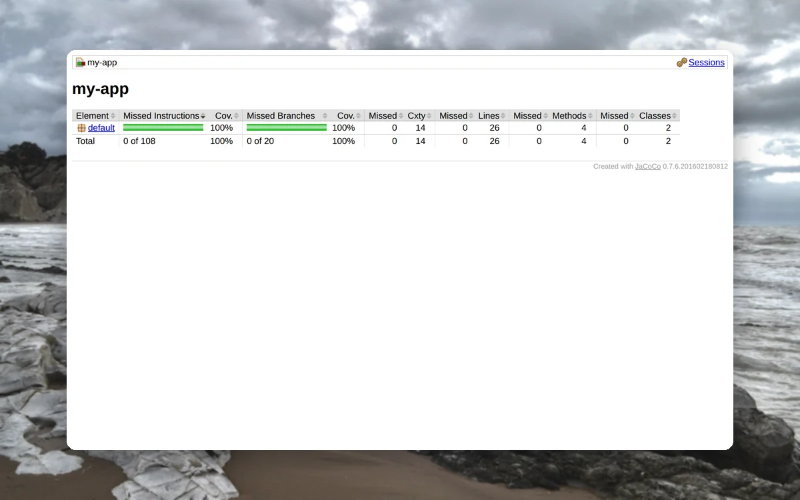
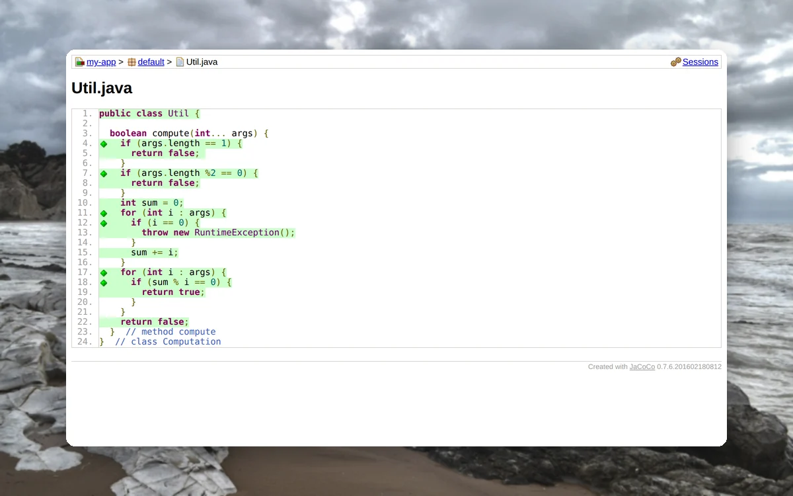
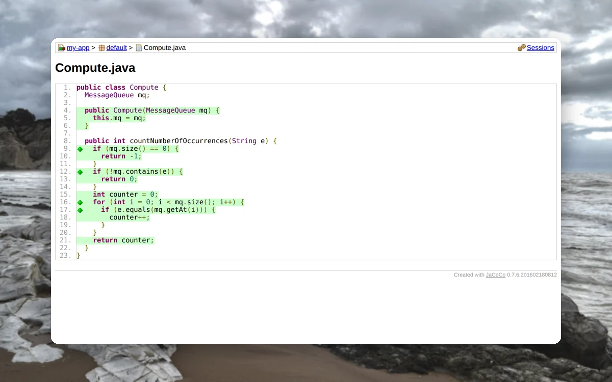
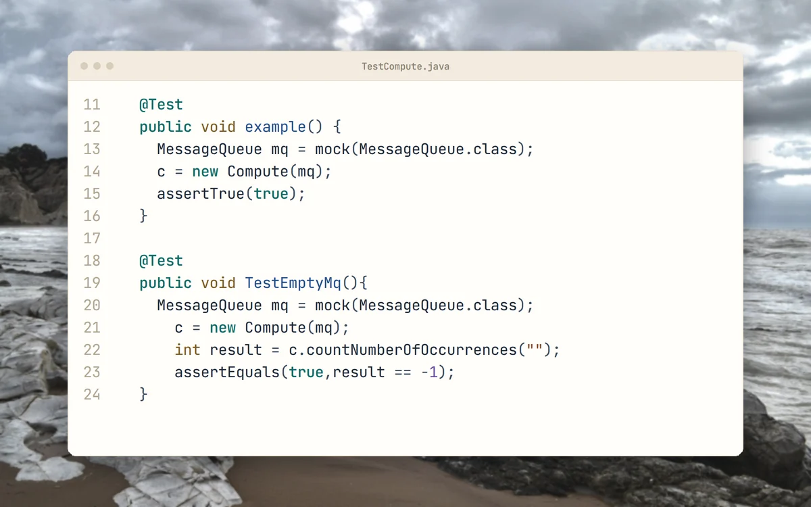

<p align="center">
  <picture>
    <source media="(prefers-color-scheme: dark)" srcset="docs/brand/svg/481-project-2-logo-on-dark.svg">
    
  </picture>
</p>

<h1 align="center">Course starter code. Plus the tests that cover it.</h1>

<p align="center">
  Archived Software Engineering coursework (course 481), second project, 2019.<br>
  <b>Branch-coverage tests with JUnit, Mockito and JaCoCo, on top of the course starter code.</b>
</p>

<p align="center">
  
  
  
  
  <a href="https://github.com/mertkayacs/SecondProjectFor481"></a>
</p>

<p align="center">
  <a href="#quick-start"></a>
  <a href="branchCoverage/my-app/src/test/java/TestCompute.java"></a>
  <a href="https://mertkayacs.com/?utm_source=github&utm_medium=readme&utm_campaign=SecondProjectFor481-repo&utm_content=portfolio-badge"></a>
</p>

<p align="center">
  <picture>
    <source media="(prefers-color-scheme: dark)" srcset="docs/assets/readme/hero-dark.webp">
    
  </picture>
</p>

481 Project 2 is the second project of a Software Engineering course. The repository holds eight small Java exercises that came as starter code, among them a visitor pattern demo, a method suggestion engine built on an ANTLR Java grammar and an XML graph generator. The coursework is the branchCoverage folder. That project started at 8 percent test coverage and needed JUnit tests to reach 100 percent, measured with JaCoCo. The last commit message records that JaCoCo reported 100 percent.

---

## Why 481 Project 2

The tests are the coursework, and the exercises around them are there to read.

|  |  |
|---|---|
|  **Tests for full coverage** | TestCompute.java and TestUtil.java sit in [branchCoverage/my-app/src/test/java](branchCoverage/my-app/src/test/java) and test the classes in that project. |
|  **Measured with JaCoCo** | The pom wires in the JaCoCo agent, JUnit and Mockito, so coverage is one Maven command away. |
|  **Eight exercises to read** | For example, [autocompletion](autocompletion/README.md) ranks method names by Levenshtein distance to a word. |

## A quick tour

<table>
  <tr>
    <td width="50%" valign="top">
      <picture>
        <source media="(prefers-color-scheme: dark)" srcset="docs/assets/readme/tour/report-dark.webp">
        
      </picture>
      <h3>Coverage summary</h3>
      JaCoCo reports 0 of 108 instructions and 0 of 20 branches missed for the project.
    </td>
    <td width="50%" valign="top">
      <picture>
        <source media="(prefers-color-scheme: dark)" srcset="docs/assets/readme/tour/branches-dark.webp">
        
      </picture>
      <h3>Util.java covered</h3>
      Every line and branch of Util.java is marked green in the source view.
    </td>
  </tr>
  <tr>
    <td width="50%" valign="top">
      <picture>
        <source media="(prefers-color-scheme: dark)" srcset="docs/assets/readme/tour/compute-dark.webp">
        
      </picture>
      <h3>Compute.java covered</h3>
      The same green view for Compute.java.
    </td>
    <td width="50%" valign="top">
      <picture>
        <source media="(prefers-color-scheme: dark)" srcset="docs/assets/readme/tour/tests-dark.webp">
        
      </picture>
      <h3>Mockito tests</h3>
      TestCompute mocks MessageQueue with Mockito to reach the branches of Compute.
    </td>
  </tr>
</table>

<p align="center"><sub>The report pages come from running mvn test jacoco:report with Java 8. The code card shows the test file as it is in the repository.</sub></p>

## Features

**Coursework**

- branchCoverage: JUnit tests that raise coverage of a given project from 8 percent to 100 percent.

**Starter exercises**

- visitorPattern: a company hierarchy printed and counted by two visitors.
- autocompletion: a method suggestion engine on an ANTLR Java grammar.
- xmlgraphgen: reads an XML graph and prints it as text or Graphviz.
- arithmetic, controlflowgenerator, callgraphgenerator and methodissuedetector: ANTLR grammar exercises driven by Makefiles.

## Quick start

```sh
cd branchCoverage/my-app
mvn test jacoco:report
```

The coverage report is written to `target/site/jacoco/index.html`. The exercise folders each have a Makefile or README, for example `make run` in autocompletion.

### Requirements

- Java 8 and Maven for branchCoverage. The pinned JaCoCo 0.7.6 agent crashes the test JVM on Java 17, and the Mockito tests error there.
- For the ANTLR exercises, make and the ANTLR 4.6 jar at /usr/local/lib/antlr-4.6-complete.jar, the path the Makefiles use.

## FAQ

<details>
<summary><b>Is all of this code the coursework?</b></summary>

No. The eight exercise folders are starter code that came with the course. The tests in branchCoverage/my-app/src/test/java are the coursework.
</details>

<details>
<summary><b>What does 100 percent mean here?</b></summary>

Instruction, branch and line coverage of the Compute and Util classes in branchCoverage/my-app. A run with Java 8 and `mvn test jacoco:report` reports 0 missed branches and 0 missed lines for both.
</details>

<details>
<summary><b>What does the ANTLR work need?</b></summary>

Java, make and the ANTLR 4.6 complete jar at the path set in each Makefile.
</details>

If 481 Project 2 is useful to you, a ⭐ helps other people find it.

Photos behind the screenshots are credited in [docs/assets/readme/CREDITS.md](docs/assets/readme/CREDITS.md).

[](https://github.com/mertkayacs/SecondProjectFor481)
